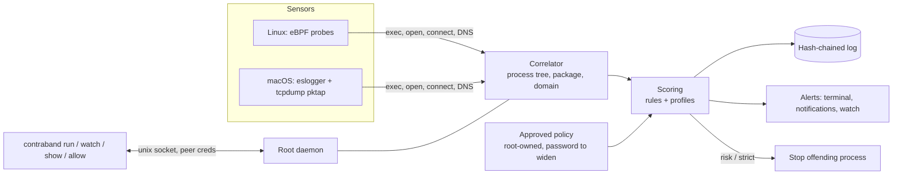

# Contraband

[](https://github.com/knight-byte/contraband/actions/workflows/ci.yml)
[](https://github.com/knight-byte/contraband/actions/workflows/security.yml)
[](https://github.com/knight-byte/contraband/actions/workflows/codeql.yml)
[](https://securityscorecards.dev/viewer/?uri=github.com/knight-byte/contraband)
[](go.mod)
[](LICENSE)

Know what your dev tools, package installs and AI agents talk to.

Contraband attributes every outbound connection on your machine to the process
tree, package and domain behind it, scores suspicious install behaviour, and
keeps a tamper-evident log. Nothing leaves the machine and no traffic is decrypted.

## How it works



## Status

Early development, monitor mode only: nothing is blocked yet.

- **Linux** (kernel 5.8+, BTF): eBPF probes.
- **macOS 13+**: Apple's signed `eslogger` and `tcpdump` (pktap), so no
  entitlement is needed. Run the daemon with `sudo` from a terminal that has
  Full Disk Access.

## Usage

```sh
sudo contraband daemon                 # start the privileged daemon
contraband run -- npm install          # audit one command
contraband watch                       # live view of your connections
contraband show <session>              # what a session did
contraband diff <session-a> <session-b>
sudo contraband export > log.jsonl     # verified, hash-chained event log
```

`contraband run` prints alerts as they happen and a per-package summary:

```
LEVEL  SCORE  PACKAGE    DESTINATIONS
alert  13     foo        45.9.148.3
log    0      (command)  registry.npmjs.org
foo: sensitive file read, then outbound connection; install script made a non-registry connection; ...
```

### Example: a credential-stealing install script

```sh
mkdir -p ~/.aws /tmp/app/node_modules/evil_package && touch ~/.aws/credentials-test
cd /tmp/app
contraband run -- bash -c 'cd node_modules/evil_package && cat ~/.aws/credentials-test && curl -s -m3 http://1.1.1.1/ -o /dev/null'
```

```
contraband: ALERT evil_package (score 13): read ~/.aws/credentials-test, ran curl, sent to 1.1.1.1

contraband: 1 package needs review (session 77604cd586badc99)

  ALERT 13  evil_package
            read     ~/.aws/credentials-test
            ran      curl
            sent to  1.1.1.1 (raw IP)

  inspect:      contraband show 77604cd586badc99
  if expected:  contraband allow -package evil_package 1.1.1.1
```

A normal install:

```
$ contraband run -- npm install esbuild
contraband: ✓ no issues (session 31d0a8fed6b3e6d6)
  ✓         npm  registry.npmjs.org
```

Stop it instead of only reporting:

```sh
contraband run -enforce strict -- npm install
```

### Policy

`.contraband.yml` lists the destinations a project is expected to reach:

```yaml
version: 1
allow:
  - domain: registry.npmjs.org
  - domain: "*.github.com"
    package: esbuild
```

The file is only a proposal. The daemon enforces an approved copy kept in its
own root-owned directory, and approving needs your account password every time:

```sh
contraband allow -package esbuild github.com   # edit the file and approve
contraband approve                              # approve manual edits
```

The password is read from the terminal only and checked by the OS, and
failures are rate-limited. An AI agent, a script, or the code being audited
can edit the file but cannot approve it, even with cached `sudo` rights.

When `run` flags a package, it prints the next steps:

```
inspect:      contraband show <session>
if expected:  contraband allow -package evil 1.1.1.1
```

### Automatic sessions

You don't have to remember `contraband run`. When a listed program runs
outside a session, the daemon starts one for it: package managers (npm, pip,
cargo …), AI agents (claude, codex …) and runtimes (node, python), so a
dependency that phones home while your app runs is covered too. Alerts from
these sessions arrive as desktop notifications and in `contraband watch`.

Inside one node or python process every package shares a pid, so runtime
traffic is attributed to the app (command and directory), not to the package.

### Enforcement

Off by default. Opt in per run, or for automatic sessions in the rules file:

| Mode | Stops a process when | Good for |
|---|---|---|
| `risk` | its session reaches ALERT, e.g. credentials read, then sent to a raw IP or paste site | AI agents: researching new sites is fine, exfiltration is not |
| `strict` | it connects anywhere not approved, not a package registry and not local | installs and CI-like runs |

```sh
contraband run -enforce strict -- npm install
```

Only the offending process and its children are stopped; on macOS its first
packet has already left by then. AI agents' own traffic is never compared with
their previous run, since research differs every time.

### Profiles

Give different programs or projects their own rules in the root-owned rules
file. The first match wins; programs and directories are each optional.

```yaml
profiles:
  - name: claude-research
    programs: [claude]
    enforce: risk
    research: true
    allow: [docs.python.org, "*.github.com"]
  - name: payments-api
    programs: [node]
    directories: [/Users/you/work/payments]
    enforce: strict
    allow: [api.stripe.com]
```

The daemon raises a health alert when the rules file changed since its last
start, since anything with cached `sudo` rights could edit it.

### Detection rules

Registries, suspicious domains and sensitive paths ship in
[`internal/score/defaults.yml`](internal/score/defaults.yml). Extend them with
a root-owned `/etc/contraband/rules.yml` in the same format.

## Development

Requires Go 1.27. Linux sensor work happens in a Lima VM on macOS.

```sh
make check        # lint, tests, govulncheck, osv-scanner, gitleaks, licenses
make generate     # rebuild BPF objects (in the VM)
make test-linux   # load the probes and run the end-to-end test (in the VM)
make hooks        # once per clone: refuse pushes that contain secrets
```

### Trying it on macOS

Give your terminal Full Disk Access (System Settings → Privacy & Security),
reopen it, then:

```sh
make build
sudo ./bin/contraband daemon                     # add -log-level debug to see raw events
./bin/contraband watch                           # in a second terminal
./bin/contraband run -- curl -s https://example.com -o /dev/null
```

Simulate a credential-stealing install script:

```sh
mkdir -p ~/.aws /tmp/app/node_modules/evil && touch ~/.aws/credentials-test
cd /tmp/app && contraband run -- bash -c 'cd node_modules/evil && cat ~/.aws/credentials-test && curl -s -m3 -o /dev/null http://1.1.1.1/'
# alert 13 evil 1.1.1.1
```

See [AGENTS.md](AGENTS.md) for code rules.

## License

Apache-2.0. The BPF program in `bpf/` is dual MIT/GPL-2.0, as the kernel requires.
